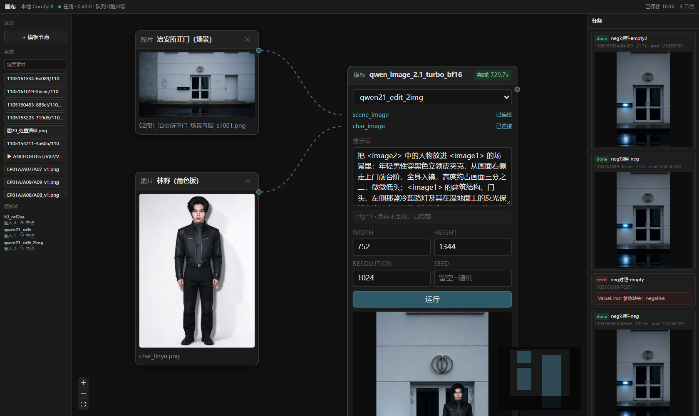

# 画布 · 本地 ComfyUI

无限画布的节点图界面，直接驱动本机 ComfyUI 出图出片。



## 一句话定位

**画布节点 = 跑一次工作流，节点之间传的是产物文件，不传 latent。**

你真实的操作是「这张图换个参考再试」「这段视频重跑个 seed」，产物级串联天然支持这些。把整条链编译成一张大图（省一次 VAE 编解码，在 3080 上约 2–4 秒）不值得为此付出编译器的复杂度。

## 启动

```bash
# 1. 确认 ComfyUI 在跑（它自己启动即可，画布只是客户端）
curl http://127.0.0.1:8188/system_stats

# 2. 起画布
python canvas/server/app.py --port 8770
#   或双击 canvas/start.bat

# 3. 打开
#    http://127.0.0.1:8770
```

前端已经构建好放在 `web/dist`，不用装 node 也能用。改前端才需要：

```bash
cd canvas/web && npm install && npm run dev    # 开发，热更新，5180 端口
cd canvas/web && npm run build                 # 改完重新构建
```

## 界面与交互

```
┌ 顶栏：画布 ｜ 运行选中 整链 ────────────────────────────────────┐
├ 左栏 素材·模板 / 节点大纲 ┬ 画布 ┬ 右栏 任务 ──────────────────┤
│                    ┌ 节点：卡外标题 + 产物 + 常驻编辑器 ┐        │
│                    └ 底部悬浮 dock ····· 左下状态条 ┘          │
└ 底栏：ComfyUI 状态 · 队列 · 保存时间 ───────────────────────────┘
```

**节点就是操作台**（对齐 LibTV 的画布）：标题在卡片**外面**一行小字（类型点 + 模型名 + 状态），
卡片里上半是产物、下半是**常驻**的编辑器 —— 提示词框、比例这类高频参数、模型下拉和 `↑` 提交，
全都在那儿，不用先点开。点产物区 = 光标跳进提示词框；双击产物 = 全屏。

参数分两层：比例 / 时长这种下拉常显，像素预算、种子这类低频项折在「高级参数 ⌄」里，
节点不会一上来就半屏高。

**节点左右两个 `＋`**：右侧派生下游（图片 → 视频、视频 → 下一镜、文本 → 图片，出来就自动连好线），
左侧加参考图（上传后自动接到同类空槽）。**加号会磁吸**：鼠标走到它 40px 以内，它就朝光标方向靠过去
（最多 12px，贴上来就停住），同时外面套一圈 16px 的隐形命中环 —— 大概 35px 内按下就能拉线，
不用瞄准那个 18px 的小圆点。加号挪，线的端点不挪：Handle 上挂了反向位移抵消（`ui/plusMagnet.js` +
`style.css` 里的 `--mag-x/--mag-y`）。

**底部悬浮 dock**：`＋` 加节点（图片/视频/文本/模板）、移动 / 选择两种工具、素材库、全部功能、
节点大纲、快捷键、紧凑模式、整理画布。顶栏只留「运行选中 / 整链」，不再堆加号。

**左下状态条**：节点数 · 连线数 ｜ 小地图 · 隐藏连线 · 网格吸附 ｜ 当前缩放（点开可选 50/75/100/150%、适应画布）。

**左栏两个 tab**：「素材 · 模板」是原来那套；「节点」是**节点大纲** —— 画布上每个节点一行
（缩略图 + 名字 + 状态点），点一下视口飞过去并选中，节点多了不用满画布找。`Ctrl/⌘ + F` 直接跳到搜索框。

**全部功能**：一张可搜索的工具表格。新建 / 图片加工（九宫格、四宫格、三视图、换角度、打光）/
产物（宫格切分、生视频、派生下游、复制、全屏）/ 画布 / 换模板。没选节点时，需要对象的那些是灰的。

**紧凑模式**：节点密集时按 dock 上的 `⇕`，所有编辑器收成一行摘要（`模型名 · 提示词开头 · 展开`），
点那一行还原。参数不丢，只是藏起来。

**添加节点**：dock 的 `＋`、双击画布空白处（就地弹类型菜单）、右键空白处。三处都行。

**多选与批量**：`Shift` 拖出选择框，或 `Ctrl/⌘` 点选；选中后顶栏「运行选中」按 x 坐标顺序排队（后端本来就是串行队列，排进去就行）。

**快捷键**：`R` 运行选中、`Ctrl/⌘ + Enter` 生成（输入框里也能按）、`Shift + R` 整链、
`F` / `Ctrl + 0` 适应画布、`Alt + Shift + F` 整理、`V` 移动工具 / `S` 选择工具、
`Ctrl/⌘ + D` 复制选中、`Ctrl/⌘ + F` 搜节点、`Delete/Backspace` 删除、`Esc` 关菜单/关全屏。
dock 上的 `⌘` 有完整对照表。输入框里打字不会误触发。

**节点悬浮工具条**：鼠标移上去，右上角出一排小按钮 —— 全屏、下载、宫格切分、生视频、复制、删除。不用先选中。

**全屏查看**：点节点里的产物图/视频即开，左右翻同一次生成的多个产物，`Esc` 退出。

**文本节点**：写一段画面描述，把右侧圆点拖到图片/视频节点的「提示词」入口。连上之后节点里显示一条虚线框和「↑ 上游文本生效」，运行时以上游文本为准；同一个描述挂在多个镜头上，改一处全跟着变。

**换模型时连线不丢**：切模板（比如从「Qwen 改图」切到「Qwen 多图编辑」）不用搬线 —— 顺序还是那个顺序，槽位按新模板重算一遍。写了一半的提示词也不丢，比例、像素这些同名参数按新模板的选项收口带过去（`16:9` → `16:9 (Widescreen)`），种子重新随机。

**输入只有一个口**：生成节点左侧就一个媒体点，图片、视频、音频全都接在这一个位置上（节点里那行写着「输入 图 2 · 视 1」）。接进来之后按**类型 + 到达顺序**自动排进模板的槽位：图片进 `imageSlots`、视频进 `videoSlots`、音频进 `audioSlots`，各自从第 1 位往后排。

接到一个没有这类槽位的模板上会被拒；如果接的是图片、模板又恰好不吃图，会顺手切到同类里能吃图的模板（跟以前一样）。

**顺序在参数面板里调**：编辑器里有一行缩略图，左上角就是它的序号（`1 2 3…`）。**直接拖动缩略图换位置** —— 按住往左往右拖，松手前目标格子边上会出现一条青色竖线，那就是它要落的地方；拖动中的那张变虚线框。序号变了，进哪个槽就跟着变，线不用重连。挪位只在**同一类型内部**（图片区里拖不出视频的顺序），跨行也能拖。悬停格子右下角的 `✕` 是直接断开这一条。

同一行最右边有个 `＋`（组内还有空位时才出现），点它上传，新素材直接接到末尾。

**槽位没了会变灰**：接进来的素材比模板的槽位多时，排在后面的那几个缩略图会变虚线框、编号也还在，鼠标悬上去写明「这个模板没有空位放它」。换个大点的模板或者挪走前一个就好。


## 连线

连线按流向分三种颜色：**图片紫**、**视频青**、**文本琥珀（虚线）**。上游还没跑出产物时线是暗的虚线，一眼能看出这根线现在没东西可送；下游正在生成时线会流动。

| 操作 | 结果 |
|---|---|
| 拖端口到空白处松手 | 就地弹出「这根线接给谁」，选完直接建好节点并连上；从**输入口**反着拖出去，就是「这个输入由谁供给」 |
| 悬停连线 | 线中点浮出小牌子，写明它现在落到哪个槽（`图 3` / `提示词`），右边 `✕` 一步断开 |
| 双击连线 | 直接断 |
| 选中连线 | 两端出现紫色圆点，拖动就能改接到别的槽（不用删了重画）；`Delete` 也能删 |
| 右键连线 | 「断开…」 |
| 拖线过程中 | 唯一的媒体口变绿；文本线只认提示词口 |
| 右键空白处 → 断开选中节点的连线 | 一次剪掉一个节点的所有上下游 |

**连线规则是硬校验的**：文本节点只能接提示词口，媒体只能接媒体口，自己连自己、连成环都会被拒（`isValidConnection` 里带 DFS 环检测）。类型对不对得上不在这里拦 —— 拖的时候一律放行，落到节点上才判模板吃不吃这类资源，接不上顺手换模板，比在拖动中途把人挡回去好。

**几十根线汇到同一个点也不会糊成一束**：同一目标的多条线按 `mediaOrder` 的顺序给一个垂直偏移量（`Wire.jsx` 里的 `offset`），各走各的道；牌的文案就是它当前占的槽位，调顺序时牌上的字跟着变。

## 运行整链

点一个节点上的「整链」（或选中它按 `Shift+R`、或右键「整链跑到这里」），会先弹一张**执行计划**：哪几个按顺序跑、哪几个已有产物被跳过。确认了再开跑。

**为什么必须排顺序**：下游的参考图是上游产物的文件名，提交时就得知道文件名。所以是「跑完一个、拿到产物、再提交下一个」，不是一把全提交。

**跳过规则**（省 GPU 时间）：

| 情况 | 处理 |
|---|---|
| 目标节点 | 一定跑 —— 用户点的就是它 |
| 上游没产物 | 跑 |
| 上游改过参数（`dirty`） | 跑，并且它的下游全部跟着重跑（输入变了） |
| 上游有产物、参数没动 | 跳过 |

改动节点任一参数会把该节点标脏（`dirty: true`），任务跑完自动清掉。切模板同样算脏。

**过程中**顶栏显示 `整链 2/5 · 节点名` 和「停」按钮，停会连带取消正在跑的那一个。中途某个节点失败就原地停下，不会拿半截产物往下跑。

编排逻辑在 `web/src/chain.js`，是纯函数，单测在 `tools/chaintest.mjs`（11 条，覆盖跳过、脏传播、分支排序、成环拦截）。

## 图片工具（图生图）

图片节点生成出第一张图后，底下会出现「图生图」工具行，都是**拿当前这张图再加工**，一键切到多图编辑模板直接跑（脚本在 `ctx.js` 的 `IMAGE_TOOLS` / `LIGHT_PRESETS`，想加预设往数组里加就行）：

| 工具 | 做什么 |
|---|---|
| 九宫格多机位 | 一张图九个机位（正/左/右/俯/仰/背/特写/过肩/远景），切分后就是九张分镜 |
| 角色三视图 | 正/侧/背并排，锁角色形象用 |
| 打光 ▾ | 冷白顶光 / 暖黄侧光 / 冷蓝逆光 / 窗光 / 霓虹夜 / 均匀平光，六种光位各一句可执行描述 |
| 换个角度 ▾ | 左 45° / 右 45° / 俯拍 / 仰拍 |

提示词都按正向写法给（只写画面里有什么），不写否定句。

## 宫格切分

九宫格、四宫格这类拼图在短剧里就是「九张分镜压在一张图上」。点节点工具条的 `⧉`，选 3×3 / 2×2 / 2×3 / 3×1 / 1×3 或自定义行列，**在浏览器里用 canvas 切**，切成的小图走 `/api/upload` 落盘，按格子顺序铺到原节点右侧，每格都是正常素材节点，可以继续连线。

切图不占 GPU、不走 ComfyUI，切完直接能进下一步。

## 怎么用

两类节点打头：**图片生成** 和 **视频生成**。素材拖进来 → 连线 → 填提示词 → 生成。

1. 左栏「素材」里点一张图，画布上就多一个图片节点；也可以直接「上传图片」。
2. 左栏「＋ 图片生成」加一个图片节点，模型下拉里选：
   - `文生图 · Z-Image Turbo` —— 不用参考图，8 步出图，可选张数（1–4）
   - `改图 · Qwen-Image-2.1` —— 接一张参考图往里改
   - `多图编辑 · Qwen-Image-2.1（1–9 张）` —— 图 1 定构图与输出画幅，图 2–9 是参考素材；接 2 张就是「人物入景」，接 3 张以上可以做多角色 + 道具 + 风格板同框。**这是 Qwen-Image-2.1 的上限：9 张。**
3. 「＋ 视频生成」加一个视频节点，`视频 · MiniMax H3` 的参考图槽位**都是可选**：不接就是文生视频，接 1–4 张就是参考生视频（锁角色、锁场景）。
4. 从图片节点右侧圆点拖线到视频节点左边的参考图槽位，填动态提示词，选时长（默认 5 秒），生成。

每个节点里都有：模型下拉、参考图槽位（必填的标红）、提示词、比例 / 像素 / 时长 / 张数 / 种子。种子留空即随机，跑完写回节点和任务表。

**版本历史**：同一个节点保留最近 12 次结果，底部缩略图切换，下游取当前选中的那一版。多张出图时点哪张，下游就用哪张。

**捷径**：图片节点底部有「→ 用这张图生视频」，一键建视频节点并连好参考图。

**视频提示词要写全画面，不只是动作。** 实测只写「镜头缓慢前推，顶灯轻微闪烁」而不写场景，H3 会自己编一个房间出来——它没有上一帧的锚点，画面的所有内容都得由这一句给。正确写法是「画面里有什么 + 怎么动」：空荡的走廊、尽头的不锈钢门、冷白顶灯 + 镜头缓推、灯光微闪。

任务面板在右侧，能看到排队、耗时、seed、产物缩略图。画布自动保存，刷新不丢，任务状态也会恢复。

## 架构

```
浏览器 React Flow          画布 = 节点图，连线 = 数据流
      │  fetch /api/*
      ▼
canvas/server/app.py       串行队列 · 模板编译 · 产物归档（标准库，零依赖）
      │  /prompt /history /view /upload/image
      ▼
本机 ComfyUI 0.43.0
```

三层各管一件事：

| 层 | 管什么 | 不管什么 |
|---|---|---|
| 前端 | 节点图、参数表单、连线、状态显示 | 不懂 ComfyUI 协议 |
| 后端 | 模板编译、队列、上传下载、归档 | 不懂画布语义 |
| ComfyUI | 真正执行工作流 | 不懂项目结构 |

**后端只认「模板 + 参数 + 输入」这一组东西，不拆解节点语义。** 所以画布前端可以整体换掉，后端一行不用改。

## 代码结构

```
canvas/
├── server/
│   ├── comfy.py         ComfyUI 对接层（直连、上传、模板、队列、object_info 缓存）
│   ├── workflow_import.py  上传的 API 工作流 → 模板 + 槽位（靠 object_info 判类型）
│   └── app.py           HTTP API + 串行 worker + 静态服务
├── web/
│   ├── src/App.jsx      画布主组件：状态、轮询、自动保存、连线规则、工具动作
│   ├── src/ctx.js       字段解析（meta → 表单）、产物取值、图片工具预设
│   ├── src/nodes/
│   │   ├── GenNode.jsx       图片生成 / 视频生成（共用一套）
│   │   ├── MediaNode.jsx     素材节点
│   │   ├── TextNode.jsx      文本节点（连到提示词）
│   │   └── TemplateNode.jsx  通用模板节点（手填槽位，调试用）
│   ├── src/edges/Wire.jsx    连线：分色、错开、悬停牌子、断开按钮
│   ├── src/chain.js     整链编排（纯函数：跳过规则 + 拓扑排序）
│   ├── src/ui/
│   │   ├── NodeTools.jsx     节点悬浮工具条
│   │   ├── Lightbox.jsx      全屏看图
│   │   ├── SplitModal.jsx    宫格切分弹窗
│   │   ├── ChainPlan.jsx     整链执行计划预览
│   │   ├── WorkflowImport.jsx 导入工作流：解析 → 勾选槽位 → 落盘模板
│   │   └── plusMagnet.js     侧边「＋」的磁吸跟随（只动视觉，不动 Handle）
│   └── dist/            构建产物（后端直接托管）
├── tools/uitest.mjs     UI 冒烟：CDP 真点界面 + 截图，见下
├── tools/foldtest.mjs   输入槽位收拢 / 拖线展开的冒烟（真拖鼠标）
├── tools/avtest.mjs     图片 / 视频 / 音频三组槽位的分组与落槽冒烟
├── tools/chaintest.mjs  整链编排单测（纯逻辑，不占 GPU）
├── tools/chainlive.mjs  整链实跑：真调 ComfyUI，验顺序与新图传递
├── tools/importtest.mjs 导入工作流全链路（选文件 → 勾选 → 建节点）
├── assets/<jobId>/      每次执行的产物，按任务 ID 归档
├── assets/uploads/      画布内上传的参考图、切出来的宫格
├── projects/            画布图（default.json）、任务表、前端错误日志
└── seed_demo.py         塞一个演示图
```

## UI 冒烟（改界面后跑一遍）

`canvas/tools/uitest.mjs` 用 Chrome DevTools Protocol 直接点界面，量 DOM 断言，顺手截图。不需要装 playwright / puppeteer，Node 22 自带 WebSocket。

```bash
# 先起一个临时实例，别对着 projects/default.json 跑（切分会在画布上建节点）
node canvas/tools/uitest.mjs http://127.0.0.1:8771 canvas/projects/_smoke
```

现在覆盖 19 项：页面加载、节点渲染、文本→提示词生效、悬停出工具条、全屏查看开关、切分弹窗、切出 9 张、右键菜单、图生图工具行、整链计划、上游改参数后计划变长、计划可取消、连线条数、连线分色、悬停连线出槽位名、拖线到空白处建节点、选中连线出改接接头、一键断开。全过会输出 `19/19 通过`。

截图落在第三个参数指定的目录，出问题直接看图。

输入槽位的收拢/展开单独有一个，因为它必须靠真拖拽才能验：

```bash
node canvas/tools/foldtest.mjs http://127.0.0.1:8771 canvas/projects/_foldshot
```

16 项，量的是 DOM：默认只一行、点开是 9 槽 + 自动分配、不吃图的模板只有探测口、拖线半路不展开、靠近才展开、拖线途中离开不收、松手收回、**收拢态连线还在**、落点在第 1 个槽。最后两项是这一轮最容易踩的坑：收拢时若把槽位 handle 卸载掉，边就画不出来，数据还在但看着像断了。

生成节点上那排功能按钮（打光 / 角度 / 三视图 / 九宫格 / 生视频）单独有一个，**真点界面但不占 GPU**：

```bash
node canvas/tools/genbtn.mjs http://127.0.0.1:8770
```

它在页面装载前把 `fetch` 换掉，只拦 `POST /api/run` —— 拿到按钮真正要提交的载荷就返回一个假任务，ComfyUI 一次都不碰。18 项：组合器能展开、打光菜单六个光位、按钮确实发出提交、模板切到 `qwen21_edit_multi`、**比例落在目标模板的选项里**、带上了当前产物做图 1、提示词非空、生视频建节点并连好线、视频节点工具条有全屏/下载。开头备份 `default.json`，收尾还原（点按钮会改节点模板并触发自动保存）。

侧边 `＋` 的磁吸单独验，用的是 CDP 的真鼠标事件：

```bash
node canvas/tools/magnet.mjs http://127.0.0.1:8770
```

9 项：加号进入磁吸态、位移方向朝光标、位移不超过 12px、吸住时可见、**Handle 一动不动**（线的端点不变，这条最容易踩坑）、在加号旁边按下能拉线、移开后归位。截图落在 `canvas/projects/_uishot/magnet.png`。测试会把探针元素打上 `data-mag-probe` —— 节点挨得近时会有好几个加号同时被吸住，不标记就会量错元素。

另外两个是「不占 GPU / 真占 GPU」的分层验证：

```bash
node canvas/tools/chaintest.mjs                                  # 编排单测，11 条，秒出
node canvas/tools/chainlive.mjs http://127.0.0.1:8772 canvas/projects/_chainshot
```

`chainlive` 会真跑一条「文生图 → 改图」的两节链（约 3 分钟 GPU），验的是两件光看截图看不出来的事：**下游是在上游跑完之后才提交的**（并发恒为 1），以及**下游拿到的输入就是上游这一次的新产物**（比对 `job.inputs.image_1 === 上游 .outputs[0].assetId`）。它自己会先把画布重置成固定 fixture，节点 id 每次带时间戳——复用 id 的话，画布一打开就会从任务历史里把旧图找回来。

导入工作流那条链单独验（会写模板目录、会往画布加节点，跑完自己清干净）：

```bash
node canvas/tools/importtest.mjs http://127.0.0.1:8770 canvas/projects/_impshot
```

20 项：入口能开、文件能解析、媒体/提示词/种子/比例都认得出来、第一张图默认必接、第二张默认可选、取消勾选掉计数、创建后左栏出新模板（带「导入」标记）、画布上多出用它的节点、槽位摘要和标签对得上。它开头会把 `projects/default.json` 备份到截图目录，收尾还原——跑之前别在画布上正编辑东西。

媒体槽到底该怎么喂，有一个不占 GPU 的全模板体检（新增模板后顺手跑一次）：

```bash
python canvas/tools/slottest.py
```

它把每个模板每条媒体槽的落点和喂法列出来：`LoadImage / LoadVideo / LoadAudio / VHS_LoadVideo` 要**先上传、再给文件名**，`VHS_LoadVideoPath / VHS_LoadAudio` 吃**绝对路径**。47 条槽现在是全过的；判错的后果不是参数不对，而是 ComfyUI 的 `validate_inputs` 打回 `Invalid video file`，整单 400 且指不到槽位。

## 模板 = 函数 + 一张说明卡

模板是 ComfyUI 导出的 API JSON，里面用 `{{slot}}` 标出可变位置。同名的 `.meta.json` 是给它配的**展示层说明**（纯 UI 用，不参与执行）：

```jsonc
// templates/h3_ref2va.meta.json
{
  "label": "MiniMax H3 视频",
  "use": "videogen",                       // 归到哪类节点：imagegen / videogen
  // 没连线就整枝摘掉，不报错。图片/视频/音频靠槽名区分，后端按 ref_image_/ref_video_/ref_audio_ 分成紫/青/黄三组
  "optionalSlots": ["ref_image_0", "…", "ref_image_8", "ref_video_0", "…", "ref_audio_2"],
  "slotLabels": { "ref_image_0": "参考图 1（人物 / 场景锚点）", "ref_video_0": "参考视频 1（2–15 秒）" },
  "fields": [                              // 节点里按这个顺序渲染控件
    { "slot": "prompt", "label": "动态提示词", "type": "textarea", "rows": 6 },
    { "slot": "aspect", "label": "比例", "type": "select", "preset": "aspect" },
    { "slot": "duration", "label": "时长（秒）", "type": "number", "min": 2, "max": 15 }
  ]
}
```

字段类型有 `textarea / text / number / select / seed`，`preset: "aspect"` 会展开成八种标准画幅（值必须和 ComfyUI `ResolutionSelector` 的枚举逐字一致）。没有 meta 的模板退回按槽位名猜，不会报错。

## 导入工作流（上传 API json 自动出槽位）

手写模板终究要一条条挑槽位。左栏模板区的「＋ 导入」接受一份 ComfyUI **API 格式**的 json（`工作流 → 导出（API）`，或开开发者模式后「保存（API 格式）」），解析出可参数化的输入，勾一遍就生成模板。

判断依据是 `/object_info` 而不是猜名字——输入类型、默认值、取值范围、AUTOGROW 最小路数都是节点自己声明的：

| 认什么 | 怎么认 |
| --- | --- |
| 图片 / 视频 / 音频 | 值带 `png/jpg/webp…`、`mp4/webm…`、`wav/mp3…` 扩展名；或 VHS 节点声明了 `vhs_path_extensions`；或 `image_upload`；或下拉选项全是图片 |
| 提示词 / 负向 | `STRING` 且字段名带 prompt；字段名带 negative；接在采样器 `negative` 口上的普通 `text` 节点（一个节点里同时有 `prompt` 和 `negative_prompt` 时以字段名为准） |
| 种子 | `seed` / `noise_seed`，或 `INT` 带 `control_after_generate` |
| 比例 / 像素 / 张数 / 宽高 | `aspect_ratio`（选项和八种标准画幅对得上就用中文标签）、`megapixels`、`resolution`、`batch_size`、`width`、`height` |

默认勾「媒体 + 提示词 + 种子 + 上面那几个常用参数」；`steps / cfg / sampler_name` 之类的收在「其他参数」里，默认不勾——一张工作流能认出十几项，全做成槽位会把生成节点撑成一屏。

三条硬规矩：

1. **媒体槽名固定 `image_N / video_N / audio_N`**，自动重新编号。后端 `slot_media_kind` 和前端 `isMediaSlot` 都只看名字里有没有 image/video/audio，顺序和名字必须自洽；普通参数撞上这三个词会自动加 `p_` 前缀。
2. **「可选」只在能摘枝时才给**。只有上游喂的是 `COMFY_AUTOGROW_V3` 且 `min=0` 的口，剪掉才安全（H3 的 `ref_images`、Qwen 的 `images` 都算）；喂 ControlNet 那种必填口的，勾选框直接禁用，因为剪掉会校验失败。默认策略：一组的第一个槽必接，多路时才默认可选。
3. **`filename_prefix` 一律改写 `{{prefix}}`**，产物按 jobId 归档。

字段默认值取工作流里的原值，所以导入的节点一打开就是那条工作流的原始状态；种子例外，留空即随机。内置模板（没有 `imported: true` 的）不许覆盖也不许删，导入的模板在左栏悬停会出现 ✕。

限制：只吃 API 格式，界面格式的 `workflow.json` 会直接报错并给出导出路径；`BOOLEAN` 输入暂不做槽位（下拉会把布尔转成字符串，ComfyUI 会打回）。

### 换机器导入的坑：模型名、幽灵节点

别人的工作流导进来，最快崩的不是槽位，是图里写死的东西：

- **模型名缺子目录**。模板写 `qwen_image_vae.safetensors`，本机实际在 `qwen\` 下 —— ComfyUI 只认 `/object_info` 里那张清单，一个值不对就整单 400，报错还只给节点号。所以编译时（`align_model_names`）会把 Loader 的取值跟本机清单对一遍：**同名文件唯一**就自动补全目录（日志 `tpl.model_alias`），零个或多个候选就提前报「模板里的模型本机没有：…（本机相近：…）」，不让它带着错值去撞 ComfyUI。
- **少数改名**。`FlowMatchEulerDiscreteScheduler` 在旧版 ComfyUI 里叫 `simple`。这类有把握的等价关系写在 `ENUM_ALIASES` 里，命中会记一条 `tpl.model_alias`；别的地方**不猜模型**——选错量化版本会悄悄改变出图。
- **同一个值两种写法**。比例最典型：`ResolutionSelector` 的枚举是 `16:9 (Widescreen)`，而导入的 Krea2 工作流把同一件事写成 `16:9`。换模板时原样搬过去就是 `value_not_in_list`，整单 400 且只回一个节点号。编译时（`align_enum_params`）会按「**比例相同且候选唯一**」还原成落点认可的写法（日志 `tpl.enum_map`），还原不了就当场报出可选清单（`tpl.enum_bad`）；前端 `coerceParam` 在点工具按钮时也按目标模板的选项先收一遍，两头都拦。
- **媒体入口有两套节点，喂法相反**。原生 `LoadVideo / LoadAudio`（还有 VHS 的 `VHS_LoadVideo`）的 `file` 是**从 ComfyUI input 目录现列的 COMBO**，只列根目录文件；给绝对路径会被 `validate_inputs` 打回 `Custom validation failed: Invalid video file`。`VHS_LoadVideoPath / VHS_LoadAudio` 则是 STRING 路径，直接读绝对路径更省一次拷贝。编译时按落点的输入类型判（`input_dir_loader`：COMBO → 先上传，STRING → 给路径），**不看类名**——`VHS_LoadAudio` 名字里带 Load 却只吃路径，就是反例。上传视频时落到 input 根目录（`upload_image(..., subfolder="")`），不能放 `canvas/` 子目录，那边看不见。
- **幽灵节点**。导出时混进来的笔记 / 占位节点，`class_type` 被写成了一句人话（`忽略多组孤海`），本机没有这个节点、又没人引用它，却会让 `/prompt` 整单 400 `missing_node_type`。导入和编译两处都会把它摘掉（`drop_orphan_unknown`，日志 `tpl.drop_orphan` / `tpl.import.orphan`）；**有人引用的未知节点不删**，那是真缺插件。

## 几个刻意的设计

**1. 模板 = 函数，画布 = 调用**

后端扫出槽位 → 前端按 meta 生成表单 → 提交时深拷贝填充。模板永远只读。深拷贝这一条不能省——模板被改一次就会导致全线错参，而且极难查。

**2. 可选参考图靠「摘枝」，不靠传空文件**

H3 的 `ref_images` 是 AUTOGROW(min 0)，少一路照样能跑；但模板里的 `LoadImage` 节点留着就会要求传文件。所以 `optionalSlots` 里声明过的槽没连线时，后端把喂它的节点连同指向它的连线一起删干净，再提交。实测 0 张 → 删 4 个 LoadImage，1 张 → 删 3 个。

**3. 强制注入 filename_prefix**

每次执行都把 `prefix` 注成 jobId，产物落在 `assets/<jobId>/`。不再有 `AIGCTYD2_00001.mp4` 这种事后无法归属的文件。

**4. 串行队列，不并发**

ComfyUI 本身就是单队列，3080 的 20GB 显存也不允许两条 20GB 模型同时驻留。并发提交只会互相排队，还多抢显存。

**5. 连线状态实时派生，不存进节点数据**

图片输入从「连线的上游节点产物」现算，节点里只显示结果。存两份必然不同步——这个 bug 第一版就踩了，槽位明明连上了还显示「拖入」。

**6. seed 留空就随机，但一定记录**

不记录 seed 的产物等于不可复现。跑完把实际 seed 写回任务，节点和台账里都能查到。

**7. 负向提示词在这个模型上直接隐藏**

`qwen_image_2.1` 是 `CFGGuider cfg=1.0`，CFG 公式 `out = neg + cfg×(pos−neg)` 代入 cfg=1 就是 `out = pos`——负向被完全抵消。`h3_ref2va` 用 `BasicGuider`，压根没有 negative 输入口。

实测（同种子同提示词只改负向）：**逐像素完全相同，差异采样点 0/3,170,304**。

所以后端 `/api/templates` 会探测模板的 `cfg` 和是否有负向输入，返回 `supportsNegative`；前端据此**直接不渲染负向输入框**，只留一行说明。这样换回支持 CFG 的模板时，负向框会自动出现，不用改代码。

提示词里出现否定表述（`不要 / 禁止 / 避免 / no / without`）会弹黄色警告——这类模型没有负向分支，提到什么就生什么。

写法规范见 [`../docs/正向提示词写法.md`](../docs/正向提示词写法.md)。

## 和 batch-render 的关系

共用同一套模板和同一层对接代码：

- `canvas/server/comfy.py` 从 `batch-render/batch_render.py` 抽取而来
- 模板目录就是 `batch-render/templates/`
- 画布出的图和 `batch_render.py` 批跑出的图落在不同目录（`canvas/assets/` vs `batch-render/out/`），互不干扰

画布适合「探索和调整单个镜头」，批量脚本适合「20 个分镜一次跑完」。两条路都通，同一套模板。

## 模板清单

| 模板 | 节点 | 参考图 | 说明 |
|---|---|---|---|
| `z_image_t2i` | 图片生成 | 不需要 | Z-Image Turbo，8 步，可出 1–4 张 |
| `qwen21_edit_ar` | 图片生成 | 1 张（必接） | Qwen-Image-2.1 改图，比例可选 |
| `qwen21_edit_multi` | 图片生成 | **1–9 张** | 图 1 定构图与画幅，图 2–9 作参考素材 |
| `h3_ref2va` | 视频生成 | **图 0–9 / 视频 0–3 / 音频 0–3**（全可选） | MiniMax H3，全不接就是文生视频 |
| `qwen21_edit` / `qwen21_edit_2img` | 通用模板节点 | 必接 | batch-render 在用，画布侧走 `_ar` / `multi` 版 |
| `qwen21_edit_2img_ar` | 通用模板节点 | 2 张 | 已被 `qwen21_edit_multi` 覆盖，保留备用 |

`_ar` 是「比例可选」版：把 `ImageScale` 的宽高接到 `ResolutionSelector` 上，一个比例下拉就能定输出画幅。原来的 `qwen21_edit` 保持不动，`batch_render.py` 的 CSV 里 `width / height` 列的语义没有变。

**九图怎么来的**：`TextEncodeQwenImage21` 的 `images` 是 AUTOGROW 输入，名字到 `image_16` 都列着，但 Qwen-Image-2.1 实际支持的上限是 9 张，模板就按 9 张建。没连的槽照旧整枝摘掉（只接 1 张时删 8 个 `LoadImage`）。**编号允许有空洞**——只接图 1、图 4、图 9 时，提交的是 `images.image_1 / image_4 / image_9`，ComfyUI 自己按序收，实测通过，不用重编号。

多图提示词必须用官方标签 `<image1>`…`<image9>` 指代（`<imageN>` 对应画布上第 N 个槽位），不能写「第一张图」。

**H3 的四组参考位**：`MiniMaxH3ReferenceToVideo` 的入参上限是 `ref_images` 9、`ref_videos` 3、`ref_audios` 3，另有 `ref_video_audios` 3（参考视频自己的音轨，与 `ref_videos` 同号）。模板按满配建：

| 组 | 槽位 | 进图方式 |
|---|---|---|
| 图片 1–9 | `ref_image_0..8` | `LoadImage`（先传到 ComfyUI input） |
| 视频 1–3 | `ref_video_0..2` | `VHS_LoadVideoPath`，`force_rate=24`，直接读绝对路径 |
| 视频原声 1–3 | 无槽，与视频同源 | 同一个 `VHS_LoadVideoPath` 的输出 2 → `ref_video_audios.ref_video_audio_N` |
| 音频 1–3 | `ref_audio_0..2` | `VHS_LoadAudio`，直接读绝对路径 |

音视频走路径版节点，**不用先把文件拷进 ComfyUI input**（图片必须拷，`LoadImage` 只认 input 里的相对路径）。没接的槽整枝摘掉：空着是剪 15 个节点，接 2 图 + 1 视频 + 1 音频时剪 11 个。

实测（1 图 + 1 视频 + 1 音频，0.35MP / 2 秒）：608×608 / 56 帧 / 2.33 秒，120 秒出片，说明 `ref_videos` 与 `ref_video_audios` 走通。

## 已知限制

| 限制 | 说明 |
|---|---|
| 不支持 bypass / mute | ComfyUI 原生的 Ctrl+B 旁路，画布还没做。调分支时得删连线 |
| 整链不能中途续跑 | 跑到一半停了，再点一次会从头按计划重排（已跳过有产物的上游，代价可控） |
| 画布只有一个 | `projects/default.json`，没有多项目切换 |
| 没有脚本节点 / 音频节点 | LibTV 那套「剧本 → 分镜表 → 批量出图」还没做，本地也还没接 LLM |
| 打光只有预设 | 没有三维光位球，方向靠提示词描述；角度只有 4 个，不是 15 视角环绕 |
| 上传只收图片 | `/api/upload` 收 png/jpg/webp/gif/bmp，视频当参考要先进 `batch-render/refs` |
| 视频只有 H3 一个模板 | 首帧/尾帧（fl2va）那套还没接，现在是参考图模式 |
| 没有打组 | 节点不能打包成可复用的流程组，只能整块复制 |

## 下一步优先级

1. **运行整链**：点最下游节点，自动按拓扑序跑完所有上游。这是省时间最多的一条。
2. **脚本节点**：一段剧本 → 分镜表（景别/运镜/画面描述），再批量出图。这是 LibTV 最值钱的那块，本地得先解决 LLM 接入。
3. **bypass 节点 + 打组**：不改连线就能停掉某个分支；一组节点打包复用。
4. **首尾帧视频模板**：H3 的 `fl2va` + `MiniMaxH3ImageToVideo`（first_frame / last_frame 都可选），做真正的首帧生视频。

## 排查

前端报错会回传到 `canvas/projects/client-errors.log`（开发时看不到浏览器控制台，这是唯一可靠的通道）。生成链路上的每一步（点击、提交、状态、报错）另外走一条 `runtime.log`，见下面的「运行日志」。后端最近的请求路径可以从 `/api/health` 的 `recent` 字段看到。

```bash
curl http://127.0.0.1:8770/api/health | python -m json.tool
```

**只验编译不占 GPU**：`POST /api/compile` 传 `{template, params, inputs}`，返回填好的节点列表和被摘掉的节点，用来检查槽位和剪枝，不提交任务。

```bash
curl -s -X POST http://127.0.0.1:8770/api/compile \
  -H "Content-Type: application/json" \
  -d '{"template":"h3_ref2va","params":{"prompt":"推镜","aspect":"9:16 (Portrait Widescreen)","megapixels":0.98,"duration":5,"seed":9}}'
```

### 运行日志（生成链路）

生成链路上的每一步都写进 **`canvas/projects/runtime.log`**：前端点了什么、提交了什么载荷、后端什么时候收到、卡在哪个阶段、产物落了几份。前后端共用一条时间线，排查「点了生成什么都没发生」时不用猜是哪一段断的。

```bash
tail -f canvas/projects/runtime.log                 # 跟着看
grep 'node=nmw3ogprp1' canvas/projects/runtime.log  # 只看某个节点
grep '  E  ' canvas/projects/runtime.log            # 只看失败
```

格式是单行 `时间  级别  事件  key=value`（带空格的值加引号），超过 4MB 轮转成 `runtime.log.1`。

| 事件 | 谁写的 | 说明 |
|---|---|---|
| `gen.click` | 前端 | 按下生成 / 换种子 / 停止那一刻界面上的真实状态：模板、提示词字数、接了哪些素材 |
| `gen.submit` / `gen.accepted` | 前端 | 提交载荷（模板、槽位、seed、非提示词参数）与后端受理耗时 |
| `gen.state` | 前端 | 任务状态跃迁，只在变化时记一条：`from=queued to=running/done/error`，带耗时、产物数、seed |
| `gen.blocked` | 前端 | 点了生成却被拦下（提示词空、参考图没连、数量不够），`why=` 就是界面提示的那句话 |
| `gen.submit.fail` | 前端 | 请求没发出去 / 后端 4xx-5xx |
| `upload.*` / `gen.attach` | 前端 | 上传开始、结果、接入参考图 |
| `chain.*` | 前端 | 整链的起点、每一步、中断原因 |
| `job.queued` / `job.start` | 后端 | 入队与 worker 取到（排队久就看这两条的时间差）|
| `job.compiled` / `job.submitted` | 后端 | 模板编译（节点数、剪枝数、seed）与提交 ComfyUI 拿到的 prompt_id |
| `job.done` / `job.comfy.error` / `job.fail` | 后端 | 产物落盘数 / ComfyUI 报错 / 异常（带 traceback 末行）|

不翻文件也能查最近历史：`GET /api/log?node=<节点id>&limit=50`（`limit` 最大 600，内存里留最近 600 条）。

**在节点上直接看**：地址后加 `?log=1`，每个生成节点下方多一条「运行日志」，显示该节点最近 8 条前端事件（读本地缓冲，不额外发请求）。不加这个参数界面完全不变。

`node canvas/tools/logshot.mjs http://127.0.0.1:8770 clickgen` 会自动点一次空提示词的生成，把「点击 → 上报 → 落盘」整条路验一遍（空提示词会被前端拦下，不提交任务、不占 GPU）。
